<div align="center">

# 🛂 Passport Extraction System

**Extract, validate, and export passport data from a single photo.**

Upload or capture a passport bio-page, and the system reads it with Google Cloud Vision OCR, parses the Machine Readable Zone (MRZ) to the **ICAO 9303** standard, verifies every check digit, and gives you clean, editable data ready to export as JSON, CSV, or a QR code.


</div>

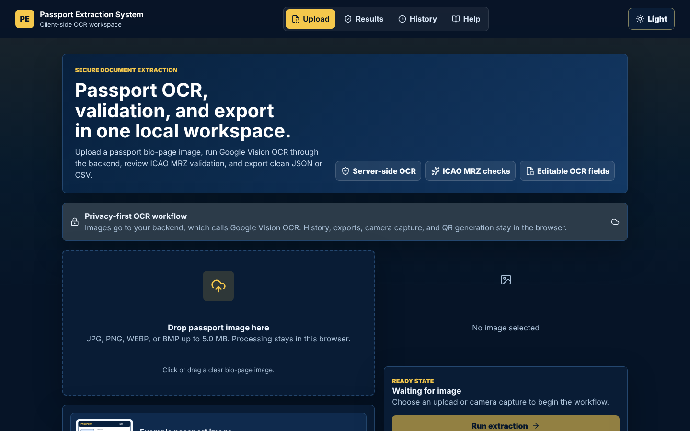

---

## Table of Contents

- [Highlights](#highlights)
- [Screenshots](#screenshots)
- [How It Works](#how-it-works)
- [Tech Stack](#tech-stack)
- [Getting Started](#getting-started)
- [Configuration](#configuration)
- [API Reference](#api-reference)
- [Project Structure](#project-structure)
- [Under the Hood](#under-the-hood)
- [Deployment](#deployment)
- [Security & Privacy](#security--privacy)
- [Limitations](#limitations)
- [Roadmap](#roadmap)

---

## Highlights

| | |
| --- | --- |
| 📷 **Upload or capture** | Drag and drop, file picker, or live camera capture, with an instant preview |
| 🔍 **Server-side OCR** | Google Cloud Vision text detection; credentials never reach the browser |
| 🧾 **ICAO 9303 MRZ parsing** | Detects TD3 passport MRZ lines and decodes every field by position |
| ✅ **17+ validation checks** | Check digits, real calendar dates, expiry status, document type, country codes, and visual-zone cross-checks |
| 🖼️ **Image quality analysis** | Blur, crop, brightness, rotation, and MRZ readability scores, with suggested fixes |
| ✏️ **Editable results** | Every field can be corrected by hand, with per-field confidence and validation badges |
| 📤 **Exports** | Copy or download JSON, download CSV, and generate a QR code, all in the browser |
| 🕘 **Local history** | Search, restore, and delete saved extractions (stored in `localStorage`) |
| 🌗 **Polished UI** | Dark and light themes, responsive layout with mobile navigation, and accessible focus states |
| ⏱️ **Timing breakdown** | Per-stage timings for preprocessing, OCR, MRZ parsing, and validation |

## Screenshots

> All screenshots use a **fictional specimen passport** from the ICAO test country *Utopia* (`UTO`). No real personal data is shown.

### Extraction results

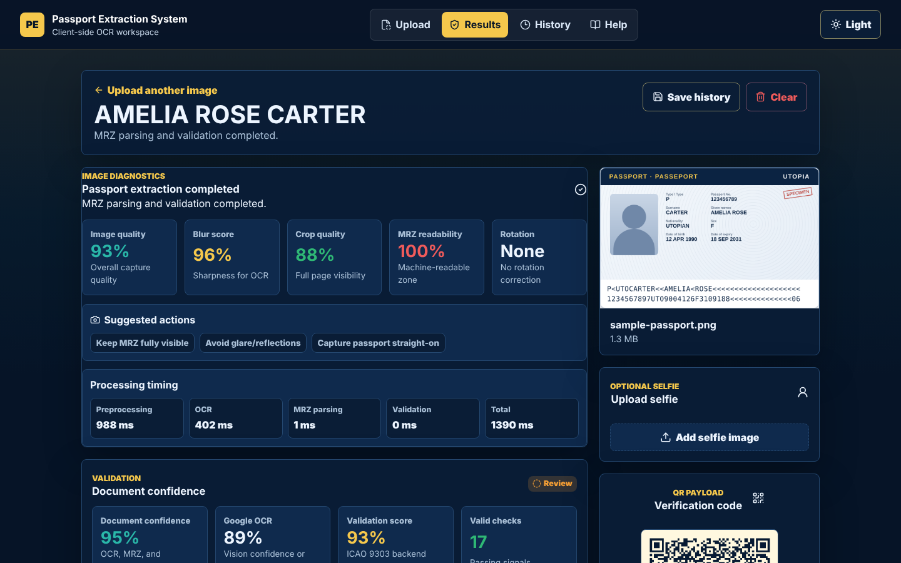

<table>
  <tr>
    <td width="50%" valign="top">
      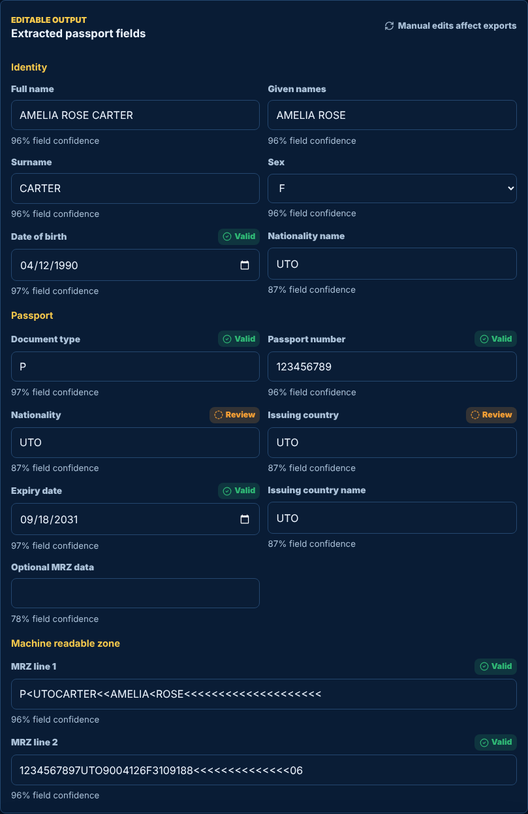<br>
      <sub><b>Editable fields</b>: per-field confidence and validation badges</sub>
    </td>
    <td width="50%" valign="top">
      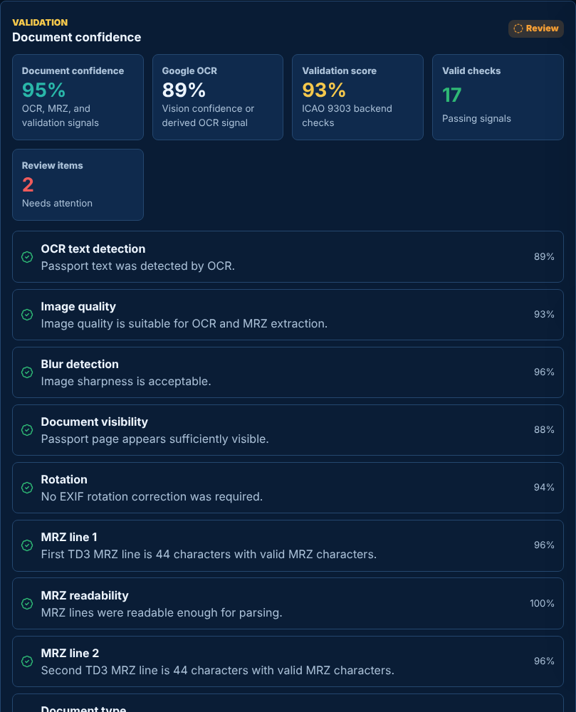<br>
      <sub><b>Validation</b>: confidence scores and individual ICAO checks</sub>
      <br><br>
      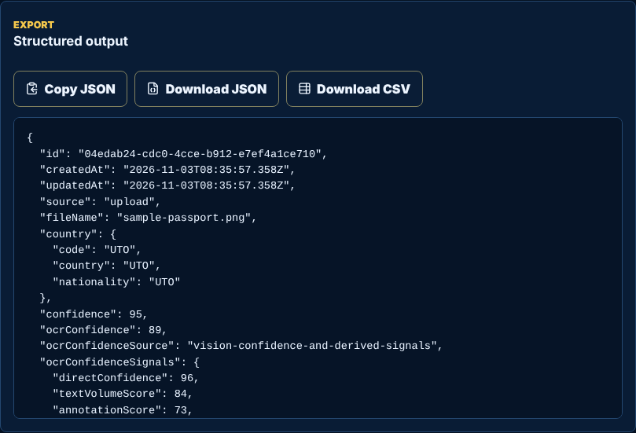<br>
      <sub><b>Export</b>: copy or download JSON and CSV</sub>
    </td>
  </tr>
</table>

### History & guide

<table>
  <tr>
    <td width="50%">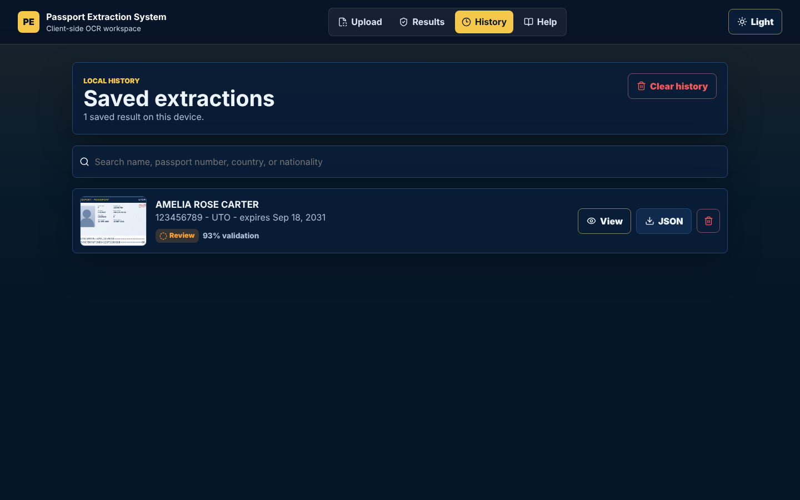<br><sub><b>History</b>: searchable saved extractions</sub></td>
    <td width="50%">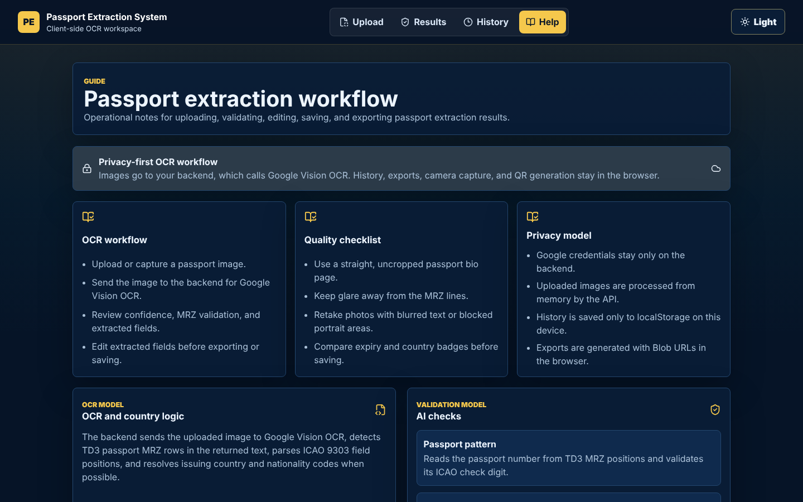<br><sub><b>Help</b>: built-in workflow guide</sub></td>
  </tr>
</table>

### Light theme

<table>
  <tr>
    <td width="50%">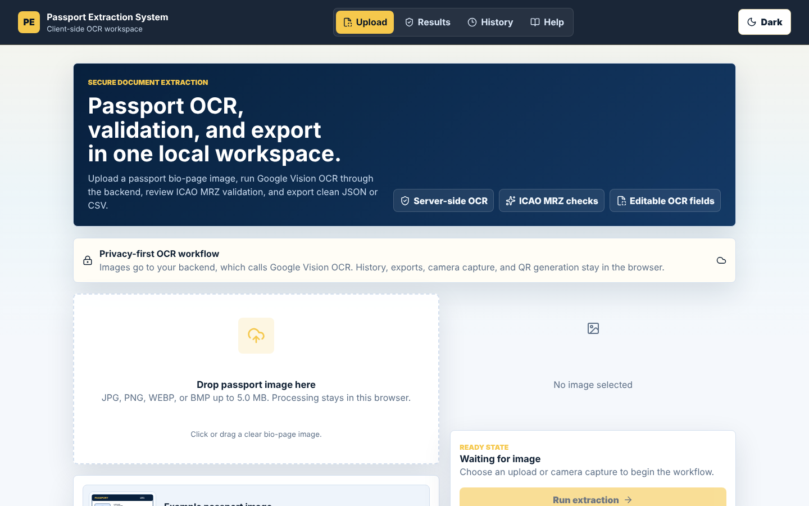</td>
    <td width="50%">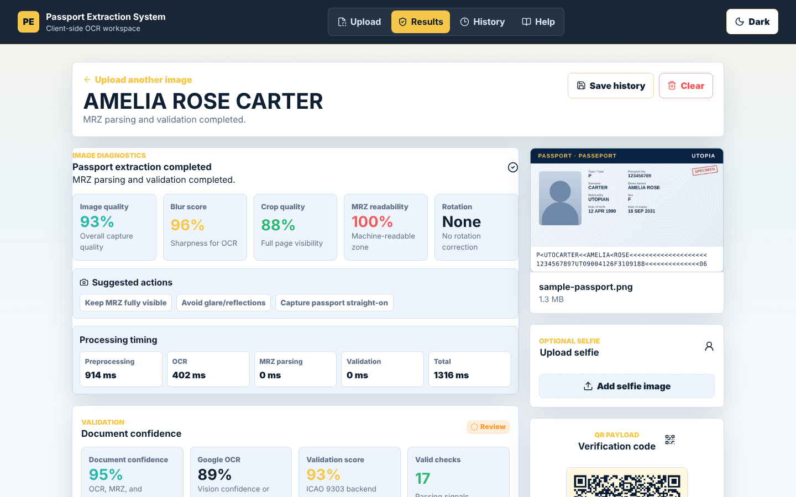</td>
  </tr>
</table>

### Mobile

<p align="center">
  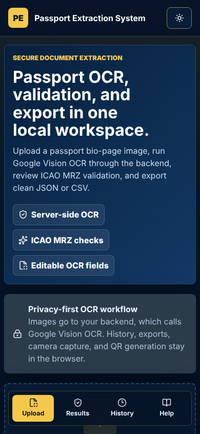
  &nbsp;&nbsp;&nbsp;
  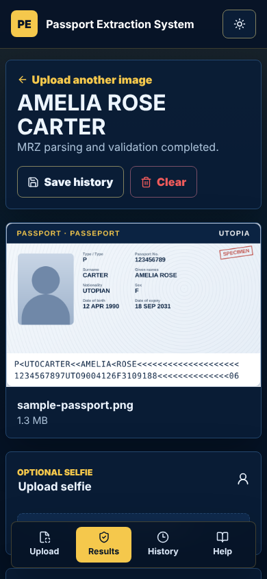
</p>

## How It Works

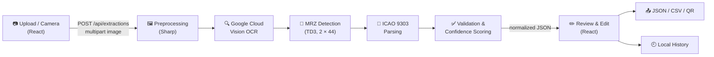

1. The user **uploads or captures** a passport bio-page image.
2. React shows a preview and sends the original file to `POST /api/extractions`.
3. The Express backend receives the image **in memory** (Multer) and **preprocesses** it: auto-orient, resize to an OCR-friendly size, trim background, and score blur, brightness, and crop.
4. The image goes to **Google Cloud Vision** for text detection.
5. The backend **detects the two TD3 MRZ lines** in the OCR text and **parses** them by ICAO 9303 position.
6. **Validation** runs: check digits, dates, expiry, document type, country codes, and a visual-zone comparison.
7. A **confidence score** is calculated, and the backend returns normalized fields, diagnostics, warnings, and timings.
8. The frontend displays the result for **review and editing**, then **export** or **save to history**.

## Tech Stack

| Layer | Technology |
| --- | --- |
| Frontend | [React 19](https://react.dev/), [React Router 7](https://reactrouter.com/), [Vite 8](https://vitejs.dev/) |
| UI | Custom CSS design system, [Lucide](https://lucide.dev/) icons |
| QR codes | [`qrcode`](https://www.npmjs.com/package/qrcode) |
| Backend | [Node.js](https://nodejs.org/) ≥ 20, [Express 5](https://expressjs.com/) |
| OCR | [Google Cloud Vision API](https://cloud.google.com/vision) (`@google-cloud/vision`) |
| Image processing | [Sharp](https://sharp.pixelplumbing.com/) |
| Uploads | [Multer](https://github.com/expressjs/multer) (in-memory, 5 MB limit) |
| Country codes | [`i18n-iso-countries`](https://www.npmjs.com/package/i18n-iso-countries) |
| Hosting | Vercel / Netlify (frontend) and any Node.js host (backend) |

## Getting Started

### Prerequisites

- **Node.js 20** or later
- A **Google Cloud** project with the **Cloud Vision API** enabled, and a service account key

### 1. Clone and install

```bash
git clone https://github.com/mechanicb0y/Passport-Extraction-System.git
cd Passport-Extraction-System

# Frontend dependencies
npm install

# Backend dependencies
npm --prefix backend install
```

### 2. Create the environment files

```bash
# macOS / Linux
cp .env.example .env
cp backend/.env.example backend/.env

# Windows
copy .env.example .env
copy backend\.env.example backend\.env
```

Then add your Google Cloud credentials to `backend/.env` (see [Configuration](#configuration)).

### 3. Run in development

Open two terminals:

```bash
# Terminal 1: backend API on http://localhost:4000
npm run dev:backend
```

```bash
# Terminal 2: frontend on http://localhost:5173
npm run dev
```

Open **http://localhost:5173** and upload a passport image.

### Available scripts

| Command | Description |
| --- | --- |
| `npm run dev` | Start the Vite dev server (frontend) |
| `npm run dev:backend` | Start the backend with auto-reload |
| `npm run build` | Build the frontend for production into `dist/` |
| `npm run preview` | Preview the production frontend build |
| `npm run start:backend` | Start the backend in production mode |

## Configuration

### Frontend (`.env`)

| Variable | Description | Example |
| --- | --- | --- |
| `VITE_API_BASE_URL` | URL of the backend API. **Required in production.** | `http://localhost:4000` |

### Backend (`backend/.env`)

| Variable | Description | Example |
| --- | --- | --- |
| `PORT` | Port the API listens on | `4000` |
| `CORS_ORIGIN` | Allowed frontend origins, comma-separated | `http://localhost:5173` |
| `GOOGLE_APPLICATION_CREDENTIALS` | Path to a service account JSON file | `./service-account.json` |
| `GOOGLE_CLOUD_CREDENTIALS_JSON` | *Or* the service account JSON as a single line | `{"type":"service_account",...}` |
| `GOOGLE_CLOUD_PROJECT_ID` | Google Cloud project ID (optional with Application Default Credentials) | `my-project-id` |

> [!WARNING]
> Never put service account files in `src/` and never expose them through `VITE_` variables. Anything prefixed with `VITE_` is bundled into the public frontend.

## API Reference

### `GET /api/health`

Health check.

```json
{ "status": "ok", "service": "passport-extraction-backend", "timestamp": "2026-11-03T08:33:48.862Z" }
```

### `POST /api/extractions`

Extracts and validates passport data from an image.

| Field | Type | Description |
| --- | --- | --- |
| `passportImage` | file | JPEG, PNG, WEBP, or BMP, up to **5 MB** |
| `source` | string | Optional: `upload` or `camera` |

```bash
curl -F passportImage=@passport.jpg -F source=upload http://localhost:4000/api/extractions
```

<details>
<summary><b>Example response (abridged)</b></summary>

```json
{
  "data": {
    "id": "04edab24-cdc0-4cce-b912-e7ef4a1ce710",
    "fileName": "passport.jpg",
    "confidence": 95,
    "ocrConfidence": 89,
    "fields": {
      "documentType": "P",
      "passportNumber": "123456789",
      "fullName": "AMELIA ROSE CARTER",
      "surname": "CARTER",
      "givenNames": "AMELIA ROSE",
      "issuingCountry": "UTO",
      "nationality": "UTO",
      "dateOfBirth": "1990-04-12",
      "sex": "F",
      "expiryDate": "2031-09-18",
      "mrzLine1": "P<UTOCARTER<<AMELIA<ROSE<<<<<<<<<<<<<<<<<<<<",
      "mrzLine2": "1234567897UTO9004126F3109188<<<<<<<<<<<<<<06"
    },
    "imageQuality": { "imageQualityScore": 93, "blurScore": 96, "cropQuality": 88, "mrzReadabilityScore": 100 },
    "processingTimings": { "preprocessingMs": 986, "ocrMs": 401, "mrzParsingMs": 0, "validationMs": 0, "totalExtractionMs": 1388 },
    "validation": { "...": "..." },
    "warnings": [],
    "suggestedActions": [],
    "rawOcrText": "PASSPORT\nUTOPIA\n...",
    "qrPayload": "..."
  }
}
```

</details>

Errors are returned as `{ "error": { "message": "...", "statusCode": 400 } }`. An oversized upload returns `413`, and an OCR provider failure returns `502`.

## Project Structure

```
Passport-Extraction-System/
├── backend/
│   └── src/
│       ├── config/        # Google Vision client configuration
│       ├── controllers/   # Extraction request orchestration
│       ├── middleware/    # Multer upload limits, error handling
│       ├── routes/        # Express routes
│       ├── services/      # Preprocessing, OCR, MRZ detection/parsing, validation, scoring
│       ├── utils/         # ICAO check digits, country codes, dates, text normalization
│       └── server.js      # Express app entry point
├── src/
│   ├── components/        # Dropzone, camera, field editor, validation, QR, exports…
│   ├── data/              # Demo passport and help content
│   ├── hooks/             # Theme, toast, camera, localStorage, extraction state
│   ├── layouts/           # App shell: header, navigation, theme toggle
│   ├── pages/             # Upload, Results, History, Help
│   ├── services/          # API client and history storage
│   └── utils/             # Date, file, and export helpers
├── index.html
├── vite.config.js
└── vercel.json            # SPA rewrites for Vercel
```

## Under the Hood

<details>
<summary><b>🧾 ICAO 9303 MRZ parsing (TD3)</b></summary>

<br>

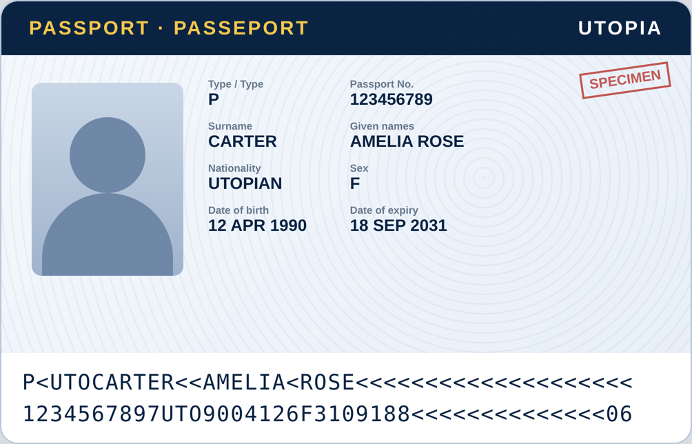

- Two lines of **44 characters** each, using only `A–Z`, `0–9`, and `<`.
- **Line 1:** document type, issuing country, surname, given names.
- **Line 2:** passport number, nationality, date of birth, sex, expiry date, optional data, and check digits.
- **Check digits** use ICAO weights `7, 3, 1` repeating, with `A = 10` through `Z = 35` and `< = 0`.

</details>

<details>
<summary><b>✅ Validation checks</b></summary>

<br>

- TD3 MRZ detection and character shape
- Passport number check digit
- Date of birth check digit, and that it's a real calendar date
- Expiry date check digit, and that the passport hasn't expired
- Composite MRZ check digit
- Passport document type
- Issuing country and nationality against ISO/ICAO country codes
- Visual-zone comparison of passport number and name against the text outside the MRZ

</details>

<details>
<summary><b>🌍 Country detection</b></summary>

<br>

The system doesn't hardcode passport-number patterns per country. The MRZ issuing-country and nationality fields are the source of truth, resolved through an ISO/ICAO country-code lookup. Unknown or special codes are flagged for **review** instead of blocking extraction.

</details>

<details>
<summary><b>🖼️ Image quality analysis</b></summary>

<br>

Using Sharp, the backend downscales large uploads to an OCR-friendly size (keeping the aspect ratio and MRZ readability), auto-orients the image, trims obvious background, and scores **blur**, **crop visibility**, and **brightness** into an overall image quality score. When text is found but the MRZ can't be parsed, the response still returns the useful OCR-derived fields, plus clear warnings and suggested actions such as *"Keep MRZ fully visible"* or *"Avoid glare/reflections"*.

</details>

<details>
<summary><b>🕘 History & exports</b></summary>

<br>

- The current extraction is stored under `passport-extraction-current-v2` in `localStorage`.
- Saved history is stored under `passport-extraction-history-v2`, deduplicated by ID and capped at **50 entries**.
- **JSON export** includes metadata, normalized fields, validation results, warnings, confidence, and raw OCR text.
- **CSV export** flattens the same data into a two-column, spreadsheet-friendly format.
- Exports and QR codes are generated **in the browser** with Blob URLs.

</details>

## Deployment

### Frontend: Vercel

1. Import the repository in Vercel.
2. Framework preset: **Vite**. Build command: `npm run build`. Output directory: `dist`.
3. Add the environment variable `VITE_API_BASE_URL` with your deployed backend URL.

`vercel.json` already includes the SPA rewrite, so client-side routes like `/results` work on refresh.

### Frontend: Netlify

Build command `npm run build`, publish directory `dist`, and the same `VITE_API_BASE_URL` variable.

### Backend

Deploy the `backend/` folder to any Node.js host: **Google Cloud Run**, **Render**, **Railway**, **Fly.io**, or a VM. Set `PORT`, `CORS_ORIGIN` (your frontend URL), and your Google Cloud credentials as environment variables.

## Security & Privacy

- 🔐 **Credentials stay on the server.** Google Cloud keys exist only in the backend environment.
- 🧠 **No image storage.** Uploads are processed in memory and are not saved by default.
- 💻 **History is local.** Saved extractions live in the user's browser `localStorage` only.
- 🚫 **Secrets are git-ignored.** `.env` files and `backend/*.json` key files are excluded from the repository.

## Limitations

- OCR uses Google Vision text detection and MRZ parsing, not Google Document AI.
- Accuracy depends on MRZ readability. Blurry, cropped, glared, or partly hidden MRZ lines may fail.
- Only **TD3 passport** MRZ is supported. ID cards (TD1/TD2) and visas need extra parsers.
- Visual-zone text is used as a consistency signal. The MRZ remains the authoritative source.

## Roadmap

- [ ] Google Document AI identity processing as the primary extractor, with Vision as a fallback
- [ ] Stronger perspective correction and dedicated MRZ-region enhancement
- [ ] Automated tests for MRZ parsing, check digits, scoring, and API error paths
- [ ] Support for TD1/TD2 identity documents
- [ ] Encrypted history or server-side audit trail for compliance needs
- [ ] Human review queue for low-confidence extractions

---

<div align="center">

Built with React, Node.js, and Google Cloud Vision.

</div>
